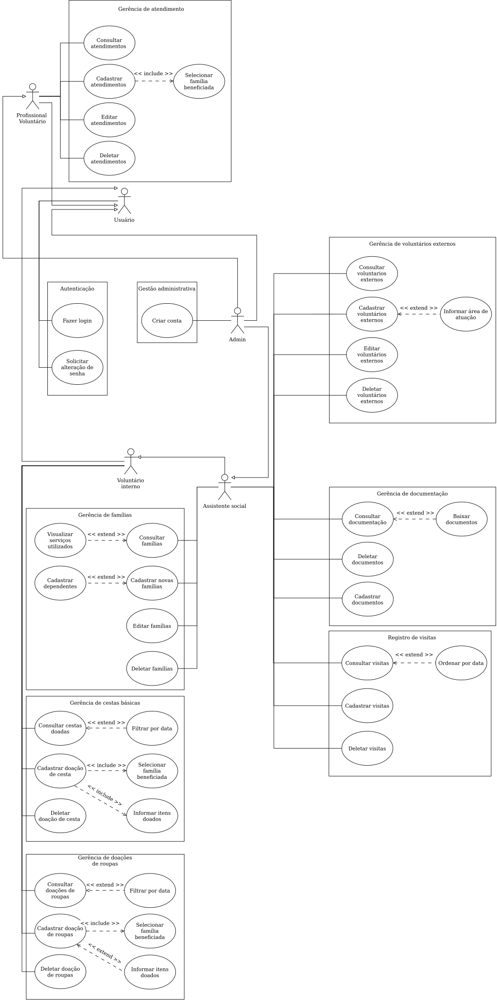

# Diagrama de Casos de Uso

A **fonte** do diagrama é o próprio [`diagrama_de_casos_de_uso.svg`](diagrama_de_casos_de_uso.svg),
um SVG **editável no [draw.io / diagrams.net](https://app.diagrams.net)** (o arquivo
carrega o modelo `mxfile` embarcado). Para editar, abra o `.svg` no draw.io, faça as
alterações e exporte novamente sobre o mesmo arquivo (Arquivo → Exportar → SVG, com a
opção "Incluir cópia do meu diagrama" marcada, para manter o modelo editável).

A **descrição** dos casos de uso está nos arquivos markdown desta pasta
([`atores.md`](atores.md), [`casos-de-uso.md`](casos-de-uso.md),
[`descricoes-textuais.md`](descricoes-textuais.md)) e no
[documento de descrição](<Descrição textual - Trabalho de DS.txt>).

## Organização

O diagrama é dividido em pacotes (limites internos), um por área funcional:

- Autenticação
- Gerência de famílias
- Gerência de atendimento
- Gerência de cestas básicas
- Gerência de doações de roupas
- Gerência de documentação
- Gerência de voluntários externos
- Registro de visitas

Os atores e a generalização entre eles estão documentados em [`atores.md`](atores.md);
a lista completa de casos de uso e suas relações `<<include>>`/`<<extend>>` em
[`casos-de-uso.md`](casos-de-uso.md).

## Revisão de notação (checklist)

- [x] Limite do sistema (pacotes nomeados)
- [x] Atores e generalização para o ator abstrato *Usuário*
- [x] Nomenclatura verbo + substantivo
- [x] Relações `<<include>>`/`<<extend>>` com direção correta (estensor → base; base → incluído)
- [x] Diagrama, atores e descrições alinhados ao [documento de descrição](<Descrição textual - Trabalho de DS.txt>)
