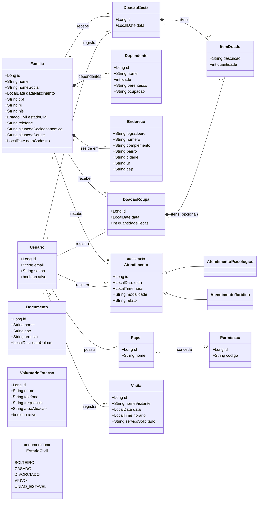

# Diagrama de Classes — Modelo de Domínio

Modelo de domínio (classes de análise) do Sistema Girassol.

> **Fontes da verdade:** apenas
> [`Descrição textual - Trabalho de DS.txt`](../casos-de-uso/<Descrição textual - Trabalho de DS.txt>)
> e o [`diagrama_de_casos_de_uso.svg`](../casos-de-uso/diagrama_de_casos_de_uso.svg).
> Os `.md` da pasta `casos-de-uso/` e `seguranca/rbac.md` são **derivados** e podem
> divergir — não são usados como fonte aqui.
>
> Como o `.txt` frequentemente não enumera atributos e o `.svg` não contém classes,
> a procedência de cada atributo/classe está na tabela
> [**Rastreabilidade**](#rastreabilidade-fonte-por-atributo): **txt**/**svg** =
> extraído da fonte canônica; **inf** = inferido (não consta nas fontes, a validar).

O diagrama é mantido como **código** (Mermaid) — versionável e renderizado direto
no GitHub. Para editar, altere o bloco ```mermaid``` abaixo.

> **Altitude:** este é o modelo de **domínio** (entidades do negócio), não o projeto
> de implementação. Camadas do Spring (Repository/Service/Controller) e mapeamentos
> JPA ficam fora deste diagrama.

## Diagrama



## Classes

Coluna "Fonte": `txt 3x` = item da seção 3 do `.txt`; `svg` = presente no diagrama;
`inf` = classe inferida (não consta nas fontes canônicas).

| Classe | Papel no domínio | Fonte |
|---|---|---|
| **Usuario** | Pessoa autenticável no sistema (assistente social, voluntário interno, profissional, admin). | txt 2 / txt 3i / svg |
| **Papel / Permissao** | RBAC: papel agrupa permissões `MODULO:ACAO`; usuário recebe papéis (N:N). | **inf** — não está no `.txt`/`.svg`; proposta de `rbac.md` |
| **Familia** | Cadastro da pessoa **representante** da família beneficiária. | txt 3a / svg |
| **Dependente** | Demais membros da família, cadastrados sob a representante (não geram cadastro próprio). | txt 3a / svg (extend) |
| **Endereco** | Endereço da família (composição — não existe sem a família). | **inf** (só "dados pessoais" no txt) |
| **Atendimento** (abstrata) | Sessão prestada a uma família; especializa em **Jurídico** e **Psicológico**. | txt 3c / svg |
| **DoacaoCesta** | Doação de cesta básica a uma família; **exige** ao menos um item. | txt 3d / svg |
| **DoacaoRoupa** | Doação de roupas; registra a quantidade de peças; itens são **opcionais**. | txt 3e / svg |
| **ItemDoado** | Item/quantidade que compõe uma doação (compartilhado por cesta e roupa). | txt 3d/3e / svg (Informar itens doados) |
| **Visita** | Atendimento avulso de visitante **sem** vínculo com família cadastrada. | txt 3f / svg |
| **Documento** | Documento institucional (estatuto, CNPJ, alvará). | txt 3g / svg |
| **VoluntarioExterno** | Voluntário da ONG que **não** usa o sistema — apenas dado gerido pela assistente social. | txt 3h / svg |

## Rastreabilidade (fonte por atributo)

Onde a fonte é `inf`, o atributo **não** aparece no `.txt` nem no `.svg` — foi inferido
e precisa de validação do grupo (ou remoção, se a entrega exigir fidelidade estrita).

| Classe | Atributos com fonte na descrição | Atributos inferidos (`inf`) |
|---|---|---|
| **Usuario** | email, senha, login *(txt 3i)* | id, ativo |
| **Familia** | — *(txt 3a diz apenas "dados pessoais da representante")* | nome, nomeSocial, dataNascimento, cpf, rg, nis, estadoCivil, telefone, situacaoSocioeconomica, situacaoSaude, dataCadastro |
| **Dependente** | — *(txt 3a: "membros cadastrados como dependentes")* | nome, idade, parentesco, ocupacao |
| **Atendimento** | tipo jurídico/psicológico, família *(txt 3c)* | data, hora, modalidade, relato |
| **DoacaoCesta** | data, itens *(txt 3d)* | — |
| **DoacaoRoupa** | data, quantidadePecas, itens opcionais *(txt 3e)* | — |
| **Visita** | nomeVisitante, data, horario, voluntário, servicoSolicitado *(txt 3f)* | — |
| **Documento** | nome/tipo, arquivo *(txt 3g)* | dataUpload |
| **VoluntarioExterno** | frequencia, ativo *(txt 3h)*, areaAtuacao *(svg extend)* | nome, telefone |

> A maior parte dos atributos de **Familia**, **Dependente** e **Atendimento** é `inf`:
> as fontes canônicas não os enumeram. A enumeração anterior vinha do
> `descricoes-textuais.md` (derivado), por isso está marcada como inferida aqui.

## Decisões de modelagem

- **Atores ≠ classes.** A generalização de atores (Usuário → Assistente social, etc.)
  é conceito de casos de uso; não vira subclasse de `Usuario`.
- **RBAC (`Papel`/`Permissao`) é opcional e fora das fontes canônicas.** O `.txt`
  (item i) e o `.svg` só preveem `Usuario` + login/troca de senha/criação de conta.
  O trio `Usuario`–`Papel`–`Permissao` é uma **proposta de design** (`rbac.md`).
  Se a entrega exigir fidelidade estrita ao `.txt`/`.svg`, manter só `Usuario` (com um
  atributo de papel/perfil) e remover `Papel`/`Permissao`.
- **Atendimento como hierarquia.** Jurídico e psicológico viram subclasses porque o
  **tipo é definido pelo profissional** (item c) e porque a confidencialidade
  (isolamento LGPD) recai sobre esses dois tipos — a separação explícita ajuda o
  controle de acesso.
- **Visita não referencia Família** (item f): visitante não exige cadastro. O vínculo
  é apenas com o `Usuario` que registrou.
- **`registra` (Usuario → registro).** Doações, atendimentos e visitas guardam quem os
  registrou, base para auditoria (ver exceção de sigilo do Administrador em `rbac.md`).
- **VoluntarioExterno e Documento são ilhas** (sem associação a Família): são dados
  institucionais geridos pela assistente social, não vinculados a beneficiários.
- **Endereco/Dependente por composição** (`*--`): não têm identidade fora da família.
  `ItemDoado` idem, dentro da doação.

## Pendências / a revisar com o grupo

- **Frequência do voluntário externo** (item h): modelada como `String frequencia`.
  Avaliar se deve virar enum ou um histórico de presenças.
- **Jurídico/Psicológico:** se a política final for "apenas registrar/editar" (pendência
  #1 dos casos de uso), a hierarquia não muda — só o RBAC.
- **Endereco:** manter como classe (composição) ou achatar como atributos de `Familia`.
- **ItemDoado compartilhado** entre cesta e roupa: confirmar se convém unificar ou
  separar (`ItemCesta` / `PecaRoupa`).
